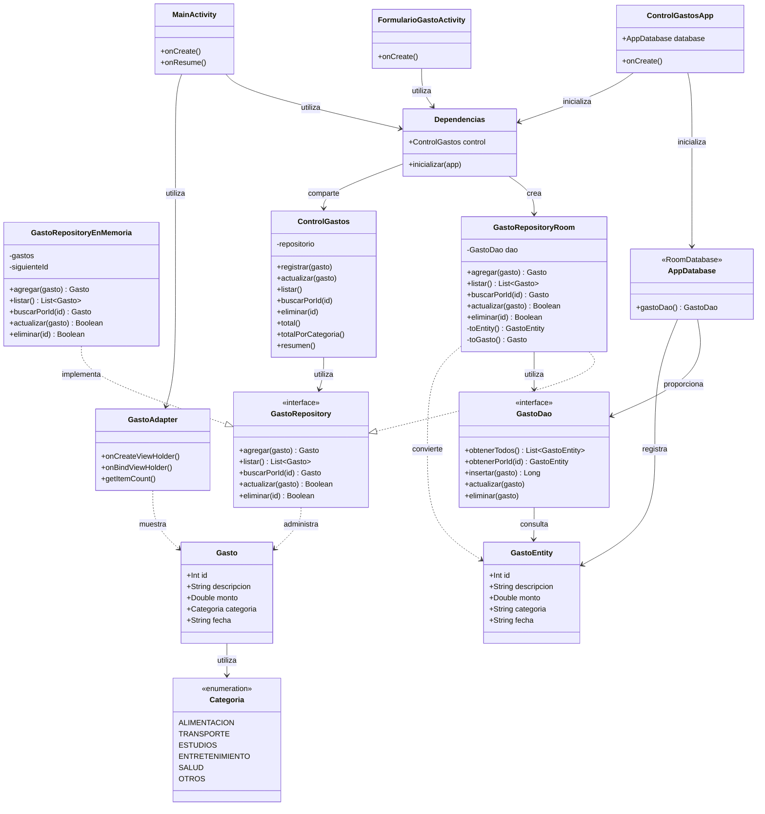

# Diagrama de clases — ControlGastos

## 1. Arquitectura actual

Este diagrama representa las principales clases del proyecto ControlGastos, incluyendo la biblioteca independiente `gastos-core` y las clases Android utilizadas para almacenar información mediante SQLite y Room.

La arquitectura mantiene separadas las responsabilidades de presentación, lógica de negocio y persistencia de datos.

## 2. Diagrama de clases

## 3. Explicación de las relaciones

### Biblioteca gastos-core

- `Gasto` representa la información de un gasto.
- `Categoria` define las categorías disponibles.
- `GastoRepository` establece el contrato para las operaciones CRUD.
- `GastoRepositoryEnMemoria` implementa el contrato mediante almacenamiento temporal.
- `ControlGastos` utiliza `GastoRepository` para acceder a los datos sin depender de una implementación específica.

### Persistencia con Room

- `GastoEntity` representa los registros de la tabla `gastos` de SQLite.
- `GastoDao` define las operaciones de inserción, consulta, actualización y eliminación.
- `AppDatabase` configura la base de datos y proporciona acceso al DAO.
- `GastoRepositoryRoom` implementa `GastoRepository` y utiliza el DAO para almacenar y recuperar gastos.
- `GastoRepositoryRoom` convierte los objetos `Gasto` y `GastoEntity` para comunicar la biblioteca con Room.

### Aplicación Android

- `ControlGastosApp` inicializa los componentes generales al arrancar la aplicación.
- `Dependencias` crea y comparte la instancia de `ControlGastos` utilizando el repositorio Room.
- `MainActivity` presenta la lista de gastos.
- `FormularioGastoActivity` permite registrar, modificar y eliminar gastos.
- `GastoAdapter` muestra los registros mediante RecyclerView.

## 4. Flujo de almacenamiento

Cuando el usuario registra un gasto, ocurre el siguiente proceso:

1. El usuario introduce la información en `FormularioGastoActivity`.
2. El formulario utiliza `Dependencias.control`.
3. `ControlGastos` valida la información y utiliza el contrato `GastoRepository`.
4. `GastoRepositoryRoom` recibe el gasto y lo convierte en `GastoEntity`.
5. `GastoDao` inserta el registro mediante Room.
6. SQLite almacena la información de forma persistente.
7. Al consultar los gastos, el repositorio convierte las entidades en objetos `Gasto`.
8. `MainActivity` recibe los datos y los presenta mediante `GastoAdapter`.

## 5. Decisiones de diseño

### Separación de responsabilidades

El proyecto mantiene separados los componentes Android, la lógica de negocio y el almacenamiento.

Esto permite modificar la interfaz o el repositorio sin reescribir completamente la aplicación.

### Patrón Repository

El contrato `GastoRepository` permite utilizar distintas implementaciones de almacenamiento.

Inicialmente se utilizó `GastoRepositoryEnMemoria`. Posteriormente fue sustituido por `GastoRepositoryRoom` para agregar persistencia.

### Persistencia

SQLite permite almacenar la información localmente y Room facilita las operaciones sobre la base de datos.

Los gastos permanecen registrados después de cerrar y volver a abrir la aplicación.

### Compatibilidad con gastos-core

La biblioteca `gastos-core` conserva su independencia de Android y Room.

Las clases de persistencia pertenecen exclusivamente al proyecto Android.

## 6. Funcionalidades futuras

La arquitectura continuará evolucionando para incorporar:

1. Registro y administración de ingresos.
2. Cálculo del saldo disponible.
3. Movimientos en quetzales y dólares.
4. Conversión monetaria mediante tipo de cambio manual.
5. Almacenamiento del tipo de cambio histórico de cada movimiento.
6. Estadísticas y resúmenes financieros.

Los nuevos modelos, repositorios y entidades se incorporarán cuando se implementen esas funcionalidades. No se representan como clases existentes porque todavía no forman parte del código actual.

## 7. Conclusión

La arquitectura actual de ControlGastos demuestra cómo una aplicación Android puede utilizar una biblioteca Kotlin independiente y almacenar información mediante SQLite y Room.

La implementación de `GastoRepositoryRoom` permitió incorporar persistencia sin modificar el contrato original del repositorio.

Esta organización proporciona una base para continuar desarrollando funciones financieras más completas.

